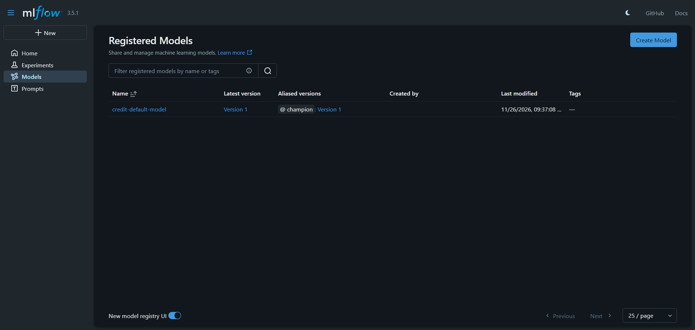

# TP 2 – MLflow et DagsHub : réponses

## Partie 0

**`mlflow` ou `mlflow==3.18.0` ?** Sans version, pip installe la dernière version disponible le jour de l'installation ; avec `==3.18.0`, il installe exactement celle-là. Si chacun installe « la dernière version », deux postes (ou le même poste à six mois d'écart) n'ont pas le même environnement : un script peut marcher chez l'un et planter chez l'autre, ou donner des métriques légèrement différentes, sans que le code ait changé.

## Partie 1

**Pourquoi des variables d'environnement plutôt que l'adresse et le token dans `train.py` ?**

- Sécurité : le token est un mot de passe ; écrit dans le code, il part dans Git et reste dans l'historique.
- Portabilité : le même script tourne sans modification sur mon poste (`.env`), dans la CI (secrets du dépôt) et dans un DAG Airflow (variables ou connexions Airflow). Seul l'environnement change, pas le code.

## Partie 2

**Étape 11 – problèmes de format du fichier brut**

1. La première ligne est un faux en-tête (`X1, X2, …, Y`) ; les vrais noms sont sur la deuxième ligne.
2. Le fichier commence par un caractère invisible (BOM), qui corrompt le nom de la première colonne.
3. La cible s'appelle `default payment next month` : un nom long, avec des espaces.
4. `PAY_0` est suivi de `PAY_2` : il n'y a pas de `PAY_1`, la numérotation est incohérente.
5. La colonne `ID` est un identifiant, pas une variable explicative : elle doit servir d'index.

**Résultat de `python prepare_data.py`** : `30000 lignes, 24 colonnes, taux de défaut = 22.1% -> data/credit_clean.csv`

**Q1.** Une correction dans Excel est manuelle : elle ne laisse aucune trace, on ne peut ni la relire ni la rejouer, et il faut la refaire (avec le risque de se tromper) à chaque nouvelle livraison du fichier. Le script décrit exactement la transformation, se relance à l'identique sur un nouveau fichier, se versionne avec Git et contrôle les données avec ses `assert`.

**Q2.** Un modèle dépend du code et des données. Si les données changent sans être versionnées, on ne peut plus reproduire un ancien modèle ni expliquer pourquoi ses métriques ont changé. Git gère mal les gros fichiers ; **DVC** (intégré à DagsHub) versionne les données à côté du code.

**Q3.** Le `rename` ne trouve plus l'ancien nom et ne renomme rien, sans erreur. C'est la ligne `assert TARGET in df.columns, ...` qui arrête le script avec le message « Colonne cible 'default' introuvable », dès la préparation des données, donc avant tout entraînement.

## Partie 3

**Qa.** Six arguments : `--data` (`data/credit_clean.csv`), `--model` (`logreg`), `--class_weight` (`none`), `--test_size` (`0.3`), `--n_estimators` (`100`), `--max_depth` (`None`). `python train.py` sans argument entraîne donc une régression logistique sans pondération sur 70 % des données : le run `logreg-none`.

**Qb.** Avec le code de l'énoncé, `--help` liste les options sans description. Un `help="..."` a été ajouté à chaque `add_argument` : chaque option est maintenant expliquée.

**Qc.** `choices` limite les valeurs acceptées. `python train.py --model xgboost` s'arrête tout de suite avec `error: argument --model: invalid choice: 'xgboost' (choose from logreg, rf)`, dès la lecture des arguments, avant le chargement des données et avant l'ouverture d'un run. C'est mieux qu'une erreur en cours d'entraînement : on ne perd pas de temps de calcul et aucun run incomplet n'est créé dans MLflow.

**Qd.** La ligne de commande ne transmet que du texte : on ne peut pas y taper la valeur Python `None`. On utilise donc le texte `"none"`, converti dans `build_model` par `cw = None if args.class_weight == "none" else args.class_weight`.

**Qe.** Il fixe deux tirages aléatoires : le découpage train / test (`train_test_split`) et la construction des arbres (`RandomForestClassifier`). Sans lui, deux lancements de la même commande donneraient des jeux de test et des forêts différents, donc des métriques différentes : on ne saurait plus si un écart vient des paramètres ou du hasard.

**Qf.** On change d'essai sans toucher au code : le code reste identique d'un run à l'autre, et `vars(args)` enregistre automatiquement dans MLflow les réglages réellement utilisés. Une tâche Airflow pourra lancer le même script avec des arguments différents, sans avoir à modifier un fichier.

**Q4.** 78 % des clients ne font pas défaut : un modèle qui répond toujours « pas de défaut » atteint déjà 0,78 d'accuracy. Ici l'accuracy vaut 0,808 mais le recall seulement 0,236 : le modèle rate plus de trois défauts sur quatre, alors que c'est l'erreur la plus coûteuse pour la banque.

## Partie 4

**Étape 20 – tableau des runs** (jeu de test, 30 % des données)

| Run | recall | precision | AUC |
|---|---|---|---|
| logreg-none | 0,236 | 0,697 | 0,715 |
| logreg-balanced | 0,628 | 0,373 | 0,716 |
| rf-none | 0,341 | 0,665 | 0,774 |
| rf-balanced | 0,595 | 0,498 | 0,775 |

Runs tracés sur le serveur MLflow de DagsHub (`https://dagshub.com/ilya32e/credit-mlops.mlflow`), expérience `credit-default`. Comparaison des 4 runs (étape 19), coordonnées parallèles colorées par recall :

Même vue colorée par accuracy : `logreg-none` y paraît bon alors qu'il a le plus faible recall (voir Q4).

**Q5.** Meilleur recall : `logreg-balanced` (0,628). Meilleure AUC : `rf-balanced` (0,775). Recommandation : **`rf-balanced`**. Il perd 3 points de recall par rapport à `logreg-balanced` (0,595 contre 0,628), mais sa precision est nettement meilleure (0,498 contre 0,373) : il déclenche beaucoup moins de fausses alertes pour presque autant de défauts détectés, et son AUC plus élevée montre qu'il classe mieux les clients quel que soit le seuil. Si la banque ne regarde que le recall, `logreg-balanced` l'emporte : c'est le choix que fait `register_best.py`.

**Q6.** `class_weight="balanced"` donne plus de poids aux erreurs sur la classe minoritaire (les défauts). Le modèle prédit « défaut » plus souvent : le recall monte fortement (0,24 → 0,63 pour logreg, 0,34 → 0,60 pour rf), mais la precision baisse (0,70 → 0,37 et 0,67 → 0,50), car davantage de clients sains sont signalés à tort. L'AUC ne bouge presque pas : le modèle ne classe pas mieux les clients, il déplace surtout son seuil de décision. On détecte plus de défauts au prix de plus de clients sains à surveiller. La vue en coordonnées parallèles de MLflow (colorée par recall) le confirme : toutes les lignes à fort recall partent de `class_weight = balanced`, quel que soit le modèle ; le choix logreg / rf joue surtout sur la precision et l'AUC.

**Q7.** Il manquerait les paramètres exacts de chaque essai, les métriques obtenues (les cellules du notebook ont été réécrites ou réexécutées), le modèle lui-même, la date, la version du code et l'environnement. On ne pourrait justifier le choix que de mémoire, sans pouvoir le prouver ni le reproduire.

## Partie 5

**Résultat de `register_best.py`** : meilleur run `logreg-balanced` (recall = 0,628), enregistré comme `credit-default-model` version 1, alias `champion`.

**Résultat de `predict.py`** :

| ID | LIMIT_BAL | AGE | PAY_1 | prediction_defaut |
|---|---|---|---|---|
| 90001 | 310000 | 32 | 1 | 1 |
| 90002 | 200000 | 28 | -1 | 0 |
| 90003 | 90000 | 41 | 0 | 0 |
| 90004 | 130000 | 31 | 0 | 1 |
| 90005 | 240000 | 23 | 1 | 1 |

**Q8.** Le fichier `.joblib` copié à la main n'a ni version ni origine : on ignore quel code, quelles données et quels paramètres l'ont produit, et le remplacer oblige à recopier un fichier et à redéployer. Avec `models:/credit-default-model@champion`, le modèle est stocké sur un serveur central, versionné, relié à son run (paramètres, métriques, signature), et l'application charge toujours la version désignée par l'alias. Changer de modèle ou revenir en arrière se fait en déplaçant l'alias.

**Q9.**

1. Lancer `train.py` avec les nouveaux réglages : un nouveau run est tracé.
2. Comparer ses métriques à celles du champion dans l'interface MLflow.
3. S'il est meilleur, relancer `register_best.py` : la version 2 est créée et l'alias `champion` s'y déplace (on peut aussi déplacer l'alias à la main dans l'interface).
4. Relancer `predict.py`, inchangé : il charge la version 2.

## Bonus

**Battre le champion.** Runs supplémentaires sur DagsHub (RandomForest, `class_weight=balanced`) :

| Run | n_estimators | max_depth | recall | precision | AUC |
|---|---|---|---|---|---|
| rf-balanced | 200 | 3 | 0,573 | 0,495 | 0,759 |
| rf-balanced | 200 | 4 | 0,570 | 0,493 | 0,763 |
| rf-balanced | 200 | 5 | 0,570 | 0,499 | 0,767 |
| rf-balanced | 300 | 6 | 0,595 | 0,494 | 0,771 |
| rf-balanced | 200 | 8 | 0,595 | 0,498 | 0,775 |

Un balayage complémentaire (`max_depth` de 7 à 15, `n_estimators` de 100 à 500) plafonne à un recall de 0,597 : les arbres plus profonds gagnent un peu de precision mais perdent du recall. Aucun RandomForest ne dépasse le recall du champion (`logreg-balanced`, 0,628) : `register_best.py` n'a donc pas été relancé, le champion reste la version 1.

**Versionner les données avec DVC.** `data/credit_clean.csv` n'est plus suivi par Git mais par DVC (`data/credit_clean.csv.dvc` contient son empreinte md5) ; le fichier est poussé sur le stockage DVC de DagsHub (`dvc push`). Les identifiants DVC sont dans `.dvc/config.local`, ignoré par Git. Le fichier brut fourni est resté dans Git, comme dans le premier commit ; il pourrait lui aussi passer sous DVC de la même façon.

**Relier chaque run à une version du code avec Git.** Après `git init` et un commit, le run `logreg-balanced` relancé porte le tag `mlflow.source.git.commit` = `c90a211…`, le commit dont il est issu. On sait ainsi exactement quel code a produit le run.

**Un modèle du Registry est-il automatiquement « bon » ?** Non : le Registry est un catalogue, il n'évalue rien. Avant de déplacer `champion`, il faut vérifier que le nouveau modèle bat l'ancien sur le même jeu de test et sur des données récentes, que la precision et l'AUC ne se dégradent pas, que la signature est compatible avec l'application, que les prédictions sont cohérentes sur quelques cas connus, et faire valider le changement par une personne.

**DAG Airflow.** `prepare_data` → `train` (une tâche par configuration, en parallèle) → `register_best` → `predict`. Informations transmises : le chemin du fichier propre (`data/credit_clean.csv`) entre `prepare_data` et `train` ; rien d'autre ne passe directement d'une tâche à l'autre, car `register_best` retrouve les runs sur le serveur MLflow par le nom de l'expérience, et `predict` charge le modèle par son nom et son alias. Toutes les tâches partagent les trois variables d'environnement MLflow.
