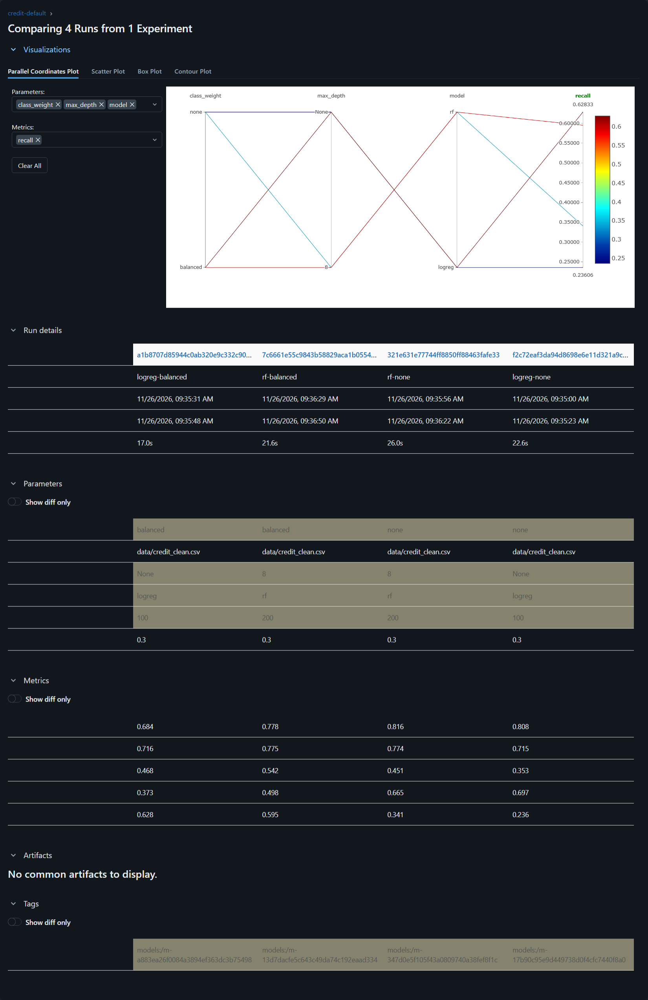
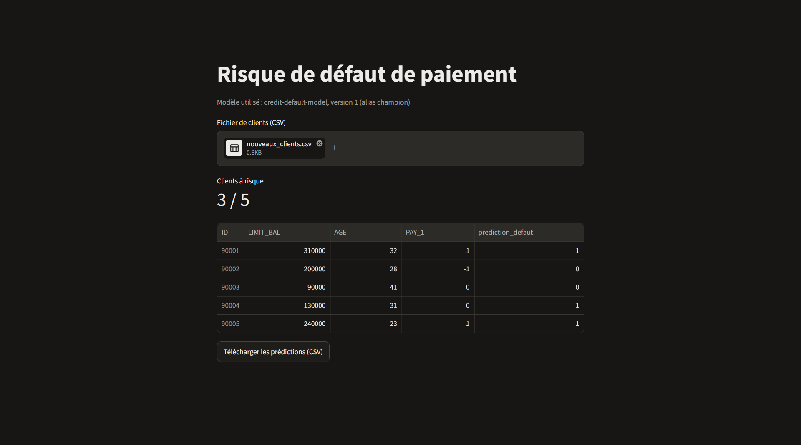

# TP 2 – MLflow et DagsHub

## Partie 0

**Différence entre `mlflow` et `mlflow==3.18.0`**

Si on écrit juste `mlflow`, pip installe la dernière version qui existe le jour où on fait l'installation. Avec `mlflow==3.18.0` on est sûr d'avoir exactement cette version.

Si chacun installe "la dernière version", on n'a pas tous le même environnement (et même sur mon propre PC dans 6 mois ce ne sera plus le même). Du coup un script peut marcher chez moi et planter chez quelqu'un d'autre, ou donner des résultats un peu différents alors que le code n'a pas bougé.

## Partie 1

**Pourquoi utiliser des variables d'environnement au lieu de mettre l'adresse et le token dans train.py ?**

D'abord pour la sécurité : le token c'est comme un mot de passe. S'il est écrit dans le code, il part sur Git et il reste dans l'historique même si on le supprime après.

Ensuite pour pouvoir réutiliser le même script partout sans le modifier : sur mon PC avec le `.env`, dans la CI avec les secrets du dépôt, ou plus tard dans Airflow avec ses variables. Il y a juste l'environnement qui change, le code reste le même.

## Partie 2

**Étape 11 : problèmes dans le fichier brut**

En ouvrant le CSV j'ai remarqué :
1. La première ligne n'est pas le vrai en-tête, c'est `X1, X2, ..., Y`. Les vrais noms de colonnes sont sur la 2e ligne.
2. Il y a un caractère invisible au début du fichier (le BOM) qui abîme le nom de la première colonne.
3. La cible s'appelle `default payment next month`, c'est long et il y a des espaces.
4. Après `PAY_0` on passe directement à `PAY_2`, il n'y a pas de `PAY_1`.
5. `ID` est juste un identifiant, ce n'est pas une variable pour le modèle, donc il faut la mettre en index.

Résultat de `python prepare_data.py` :
```
30000 lignes, 24 colonnes, taux de défaut = 22.1% -> data/credit_clean.csv
```

**Q1.** Si on corrige dans Excel, c'est fait à la main et il n'en reste aucune trace. On ne peut pas savoir ce qui a été modifié, et à chaque nouveau fichier il faut tout refaire (avec le risque d'oublier quelque chose). Avec un script, la transformation est écrite noir sur blanc, on peut la relancer pareil sur un nouveau fichier, la mettre sur Git, et les `assert` vérifient les données.

**Q2.** Un modèle dépend du code mais aussi des données. Si les données changent et qu'on ne les a pas versionnées, on ne peut plus refaire un ancien modèle ni comprendre pourquoi les métriques ont changé. Git n'est pas fait pour les gros fichiers, on peut utiliser DVC (qui est intégré à DagsHub) pour versionner les données.

**Q3.** Le `rename` ne trouve plus l'ancien nom donc il ne renomme rien, et il ne met pas d'erreur. C'est l'`assert TARGET in df.columns` qui arrête le script avec le message "Colonne cible 'default' introuvable". Ça se passe dès la préparation des données, donc avant d'entraîner un modèle.

## Partie 3

**Qa.** Le script prend 6 arguments :
- `--data` : `data/credit_clean.csv`
- `--model` : `logreg`
- `--class_weight` : `none`
- `--test_size` : `0.3`
- `--n_estimators` : `100`
- `--max_depth` : `None`

Si on lance `python train.py` sans rien, ça entraîne une régression logistique sans pondération sur 70% des données, donc le run `logreg-none`.

**Qb.** Au départ `--help` affiche les options mais sans aucune explication. J'ai ajouté un `help="..."` sur chaque `add_argument` et maintenant chaque option a sa description.

**Qc.** `choices` sert à limiter les valeurs possibles. Quand je lance `python train.py --model xgboost` j'ai directement :
```
error: argument --model: invalid choice: 'xgboost' (choose from logreg, rf)
```
Le script s'arrête dès la lecture des arguments, avant de charger les données et avant de créer un run. C'est mieux que de planter au milieu de l'entraînement parce qu'on ne perd pas de temps et on n'a pas de run à moitié fini dans MLflow.

**Qd.** En ligne de commande on ne peut passer que du texte, on ne peut pas taper la valeur Python `None`. Donc on passe `"none"` et on le convertit dans `build_model` avec la ligne :
```python
cw = None if args.class_weight == "none" else args.class_weight
```

**Qe.** Il y a deux choses aléatoires dans le script : le découpage train/test (`train_test_split`) et la construction des arbres du `RandomForestClassifier`. Le `random_state=42` fixe les deux. Sans ça, si on relance la même commande, on n'a pas le même jeu de test ni la même forêt, donc pas les mêmes métriques, et on ne sait plus si une différence vient des paramètres ou juste du hasard.

**Qf.** On peut tester plein de réglages sans toucher au code. Le code reste le même d'un run à l'autre et `vars(args)` enregistre dans MLflow les paramètres vraiment utilisés. Plus tard une tâche Airflow pourra lancer le même script avec d'autres arguments sans modifier de fichier.

**Q4.** 78% des clients ne font pas défaut, donc un modèle qui dit toujours "pas de défaut" a déjà 0,78 d'accuracy. Ici on a 0,808 d'accuracy mais seulement 0,236 de recall, ça veut dire que le modèle rate plus de 3 défauts sur 4. Or c'est justement l'erreur qui coûte le plus cher à la banque.

## Partie 4

**Étape 20 : tableau des runs** (sur le jeu de test, 30% des données)

| Run | recall | precision | AUC |
|---|---|---|---|
| logreg-none | 0,236 | 0,697 | 0,715 |
| logreg-balanced | 0,628 | 0,373 | 0,716 |
| rf-none | 0,341 | 0,665 | 0,774 |
| rf-balanced | 0,595 | 0,498 | 0,775 |

Les runs sont sur le serveur MLflow de DagsHub (`https://dagshub.com/ilya32e/credit-mlops.mlflow`), dans l'expérience `credit-default`.

Comparaison des 4 runs (étape 19), coordonnées parallèles avec la couleur sur le recall :



La même chose avec la couleur sur l'accuracy. On voit que `logreg-none` a l'air bien alors que c'est lui qui a le pire recall (cf Q4) :


**Q5.** Le meilleur recall c'est `logreg-balanced` (0,628) et la meilleure AUC c'est `rf-balanced` (0,775).

Moi je recommanderais `rf-balanced`. Il a un peu moins de recall que `logreg-balanced` (0,595 contre 0,628) mais sa precision est bien meilleure (0,498 contre 0,373). Donc il trouve presque autant de défauts mais avec beaucoup moins de fausses alertes. En plus son AUC est plus haute, donc il classe mieux les clients en général. Par contre si la banque regarde seulement le recall, c'est `logreg-balanced` qui gagne, et c'est d'ailleurs lui que `register_best.py` choisit.

**Q6.** Avec `class_weight="balanced"`, les erreurs sur les défauts (la classe minoritaire) comptent plus. Du coup le modèle prédit "défaut" plus souvent :
- le recall monte beaucoup : 0,24 → 0,63 pour logreg et 0,34 → 0,60 pour rf
- mais la precision baisse : 0,70 → 0,37 et 0,67 → 0,50, parce qu'il y a plus de clients sains signalés par erreur

L'AUC ne change presque pas, donc le modèle ne classe pas vraiment mieux, c'est surtout son seuil de décision qui bouge. En gros on attrape plus de défauts mais on doit surveiller plus de clients qui n'en avaient pas besoin.

On le voit bien sur le graphique en coordonnées parallèles coloré par recall : toutes les lignes avec un bon recall partent de `balanced`, peu importe le modèle. Le choix entre logreg et rf change surtout la precision et l'AUC.

**Q7.** Dans deux semaines je n'aurais plus les paramètres exacts de chaque essai, ni les métriques (dans un notebook on réexécute les cellules et on écrase les résultats), ni le modèle, ni la date, ni la version du code et des librairies. Je pourrais seulement justifier mon choix de mémoire, sans preuve et sans pouvoir le refaire.

## Partie 5

Résultat de `register_best.py` : le meilleur run est `logreg-balanced` (recall = 0,628), il est enregistré sous `credit-default-model` en version 1 avec l'alias `champion`.


Résultat de `predict.py` :

| ID | LIMIT_BAL | AGE | PAY_1 | prediction_defaut |
|---|---|---|---|---|
| 90001 | 310000 | 32 | 1 | 1 |
| 90002 | 200000 | 28 | -1 | 0 |
| 90003 | 90000 | 41 | 0 | 0 |
| 90004 | 130000 | 31 | 0 | 1 |
| 90005 | 240000 | 23 | 1 | 1 |

**Q8.** Le `.joblib` du TP 1 c'est juste un fichier copié à la main : on ne sait pas quelle version c'est, ni avec quel code, quelles données ou quels paramètres il a été fait. Et pour le changer il faut recopier le fichier et redéployer.

Avec `models:/credit-default-model@champion`, le modèle est sur un serveur, il a un numéro de version et il est relié à son run (paramètres, métriques, signature). L'application charge toujours la version qui a l'alias. Pour changer de modèle ou revenir à l'ancien, il suffit de déplacer l'alias.

**Q9.** Les étapes :
1. Lancer `train.py` avec les nouveaux paramètres, ça crée un nouveau run.
2. Comparer ses métriques avec celles du champion dans MLflow.
3. S'il est meilleur, relancer `register_best.py` : ça crée la version 2 et l'alias `champion` passe dessus (on peut aussi déplacer l'alias à la main dans l'interface).
4. Relancer `predict.py` sans le modifier, il utilise la version 2.

## Bonus

**Battre le champion**

J'ai testé d'autres RandomForest avec `class_weight=balanced` :

| Run | n_estimators | max_depth | recall | precision | AUC |
|---|---|---|---|---|---|
| rf-balanced | 200 | 3 | 0,573 | 0,495 | 0,759 |
| rf-balanced | 200 | 4 | 0,570 | 0,493 | 0,763 |
| rf-balanced | 200 | 5 | 0,570 | 0,499 | 0,767 |
| rf-balanced | 300 | 6 | 0,595 | 0,494 | 0,771 |
| rf-balanced | 200 | 8 | 0,595 | 0,498 | 0,775 |

J'ai aussi essayé `max_depth` entre 7 et 15 et `n_estimators` entre 100 et 500, mais le recall ne dépasse pas 0,597. Plus les arbres sont profonds, plus on gagne un peu en precision mais on perd en recall. Aucun RandomForest ne bat le champion (`logreg-balanced`, 0,628), donc je n'ai pas relancé `register_best.py` et le champion reste la version 1.

**DVC**

J'ai mis `data/credit_clean.csv` sous DVC au lieu de Git. Le fichier `data/credit_clean.csv.dvc` garde son empreinte md5 et le fichier lui-même est envoyé sur le stockage DVC de DagsHub avec `dvc push`. Les identifiants DVC sont dans `.dvc/config.local`, qui n'est pas envoyé sur Git. J'ai laissé le fichier brut dans Git comme dans mon premier commit, mais on pourrait le passer sous DVC de la même façon.

**Git**

Après `git init` et un commit, j'ai relancé `logreg-balanced`. Dans MLflow le run a le tag `mlflow.source.git.commit` = `c90a211...`, c'est le commit à partir duquel il a été lancé. Comme ça on sait exactement quel code a produit le run.

**Est-ce qu'un modèle dans le Registry est forcément "bon" ?**

Non, le Registry c'est juste un catalogue, il ne vérifie rien. Avant de déplacer l'alias `champion` il faudrait vérifier :
- que le nouveau modèle est meilleur que l'ancien sur le même jeu de test, et aussi sur des données plus récentes
- que la precision et l'AUC ne baissent pas trop
- que la signature est toujours compatible avec l'application
- que les prédictions sont cohérentes sur quelques clients qu'on connaît
- et faire valider par quelqu'un avant de passer en production

**DAG Airflow**

`prepare_data` → `train` (une tâche par configuration, en parallèle) → `register_best` → `predict`

La seule info qui passe directement d'une tâche à l'autre c'est le chemin du fichier propre (`data/credit_clean.csv`) entre `prepare_data` et `train`. Le reste passe par le serveur MLflow : `register_best` retrouve les runs avec le nom de l'expérience et `predict` charge le modèle avec son nom et son alias. Toutes les tâches ont besoin des 3 variables d'environnement MLflow.

---

# TP 2 bis – Déployer le modèle champion avec Streamlit

J'ai fait l'application `app_credit.py` dans le même dossier que le TP 2, avec le même `.venv` et le même `.env`. Je la lance avec `streamlit run app_credit.py`. J'ai ajouté Streamlit dans `requirements.txt` avec sa version (`streamlit==1.67.0`), pour la même raison que dans la Partie 0.

Ce que j'ai complété :
1. `MODEL_URI = f"models:/{MODEL_NAME}@champion"`
2. `@st.cache_resource` au-dessus de `charger_modele()`
3. `clients["prediction_defaut"] = model.predict(clients)`

En chargeant `data/nouveaux_clients.csv`, j'ai le titre, le modèle utilisé (version 1, alias champion), 3 clients à risque sur 5 et le même tableau qu'avec `predict.py` :



**Q1.** Au TP 1, l'appli chargeait `regression.joblib`, un fichier copié à la main dans le dossier. Le modèle était figé, sans version et sans lien avec son entraînement. Ici l'appli charge `models:/credit-default-model@champion` depuis le Model Registry de DagsHub. Quand on aura un meilleur modèle, il suffira de l'enregistrer et de déplacer l'alias `champion`, et l'appli l'utilisera au prochain démarrage sans rien changer ni recopier. En plus elle affiche la version utilisée.

**Q2.** Sans `@st.cache_resource`, chaque action (charger le fichier, cliquer) devient lente parce que le modèle est retéléchargé depuis DagsHub à chaque fois (on voit la barre "Downloading artifacts", environ 6 secondes chez moi). C'est parce que Streamlit relance tout le script à chaque interaction, donc `mlflow.pyfunc.load_model()` est relancé aussi. Avec le cache, le modèle est chargé une seule fois et gardé en mémoire.

**Q3.** Le modèle a besoin de 23 variables (plafond, âge, 6 historiques de paiement, 6 montants facturés, 6 montants payés...). Un formulaire serait très long à remplir et on ferait facilement des erreurs. Avec un CSV on peut traiter plusieurs clients d'un coup, c'est le genre de fichier que la banque a déjà, et on est sûr d'avoir les mêmes colonnes que la signature du modèle.

## Pour aller plus loin

**Changer de champion sans toucher au code**

J'ai enregistré le run `rf-balanced` (`max_depth=8`) en version 2 de `credit-default-model` et j'ai mis l'alias `champion` dessus. Après avoir relancé l'appli, elle affichait "version 2 (alias champion)" et 1 client à risque sur 5 au lieu de 3 (le RandomForest signale moins de clients : recall 0,595, precision 0,498). Je n'ai pas touché à `app_credit.py`. Ensuite j'ai remis l'alias sur la version 1 (`logreg-balanced`, meilleur recall) qui reste le champion. La version 2 est toujours dans le Registry.

**Télécharger les résultats**

J'ai ajouté un bouton `st.download_button` sous le tableau pour télécharger les prédictions en CSV (`predictions_clients.csv`, fait avec `clients.to_csv()`).
